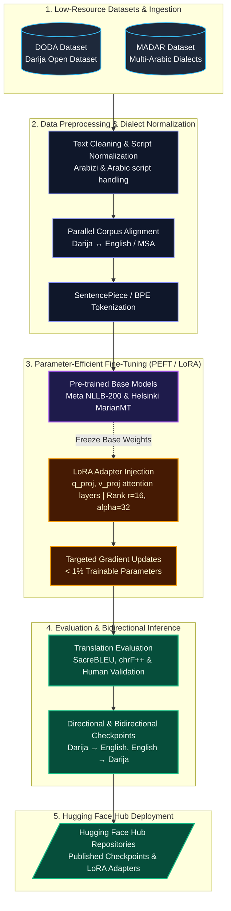

<div align="center">

# 🇲🇦 Moroccan Darija Neural Machine Translation
### Parameter-Efficient Fine-Tuning (PEFT / LoRA) with Meta NLLB-200

[](https://www.python.org/)
[](https://pytorch.org/)
[](https://huggingface.co/hamzabenX)
[](https://huggingface.co/hamzabenX/nllb_200_darija_lora_dodamadar3)
[](LICENSE)

<p align="center">
  <b>A Neural Machine Translation (NMT) system adapting Meta's NLLB-200 to low-resource Moroccan Darija (Moroccan Arabic) using Low-Rank Adaptation (LoRA).</b>
</p>

[Explore Models on Hugging Face](https://huggingface.co/hamzabenX) • [Report Issue](https://github.com/hamzaX12/Lora_Fintune_NLLB/issues) • [Author Profile](https://github.com/hamzaX12)

</div>

---

## 📋 Table of Contents
- [Overview](#-overview)
- [System Architecture](#-system-architecture)
- [Datasets & Data Dictionary](#-datasets--data-dictionary)
- [Repository Structure](#-repository-structure)
- [LoRA Hyperparameters](#️-lora-hyperparameters)
- [Installation & Setup](#-installation--setup)
- [Training Pipeline](#-training-pipeline)
- [Inference & Translation Usage](#-inference--translation-usage)
- [Evaluation & Benchmarks](#-evaluation--benchmarks)
- [Published Checkpoints](#-published-checkpoints)
- [License & Citation](#-license--citation)

---

## 📌 Overview

**Moroccan Darija** is a low-resource dialect characterized by non-standardized orthography, dialectal code-switching (Arabic, French, and Amazigh), and a scarcity of formal parallel corpora. Standard machine translation engines frequently produce hallucinations or inaccurate Modern Standard Arabic (MSA) outputs when translating conversational Darija.

This repository implements **Parameter-Efficient Fine-Tuning (PEFT)** on **Meta's NLLB-200 (No Language Left Behind)** using **LoRA (Low-Rank Adaptation)**. By freezing over **99%** of the foundation model's weights and injecting trainable low-rank decomposition matrices into the attention projection layers, this pipeline achieves high-fidelity translation with minimal computational overhead.

---

## 🏗 System Architecture



---

## 📊 Datasets & Data Dictionary

The fine-tuning pipeline leverages curated subsets from two major parallel corpora for dialectal Arabic:

| Dataset | Full Name | Primary Dialect Focus | Domain | Alignment |
| :--- | :--- | :--- | :--- | :--- |
| **DODA** | Darija Open Dataset | Moroccan Darija (Morocco) | Conversational, Daily life, Social | Darija ↔ English / French |
| **MADAR** | Multi-Arabic Dialect Applications & Resources | Multi-dialect (BTEC / Rabat / Fes) | Travel, Tourism, Queries | Darija ↔ MSA ↔ English |

### Corpus Schema

| Column Name | Data Type | Description | Example |
| :--- | :--- | :--- | :--- |
| `source_text` | `string` | Raw or normalized source input | `"Fin ghadi t-mchi l-youm?"` |
| `target_text` | `string` | Reference translation | `"Where are you going today?"` |
| `source_lang` | `string` | NLLB language identifier | `ary_Arab` |
| `target_lang` | `string` | Target NLLB language identifier | `eng_Latn` or `arb_Arab` |
| `split` | `string` | Dataset partition | `train`, `validation`, `test` |

---

## 📁 Repository Structure

```plaintext
├── data/
│   ├── raw/                       # Raw downloaded corpora (DODA & MADAR)
│   └── processed/                 # Tokenized, filtered, and aligned parquet files
├── notebooks/
│   ├── 01_eda_and_cleaning.ipynb  # Dialectal text normalization and Arabizi mapping
│   └── 02_training_lora_v3.ipynb  # Main fine-tuning notebook for nllb-darija-lora_3
├── src/
│   ├── __init__.py
│   ├── preprocess.py              # Script cleaning, orthography alignment, tokenization
│   ├── train.py                   # PyTorch + PEFT LoRA training loop
│   └── evaluate.py                # SacreBLEU, chrF++, and inference generation
├── configs/
│   └── lora_config_v3.json        # LoRA rank, alpha, target modules, and learning rate
├── requirements.txt               # Python package dependencies
├── LICENSE                        # MIT License
└── README.md                      # Project documentation
```

---

## ⚙️ LoRA Hyperparameters

For iteration 3 (`nllb-darija-lora_3`), the following parameter-efficient configuration was applied:

| Parameter | Configuration | Justification |
| :--- | :--- | :--- |
| **Base Model** | `facebook/nllb-200-distilled-600M` | Optimal trade-off between inference speed and translation capacity |
| **LoRA Rank ($r$)** | `16` | Captures cross-lingual transfer without overfitting low-resource data |
| **LoRA Alpha ($\alpha$)** | `32` | Scaling factor ($\alpha / r = 2.0$) for stable gradient updates |
| **Target Modules** | `["q_proj", "v_proj"]` | Injects adapters directly into the Multi-Head Attention projections |
| **LoRA Dropout** | `0.05` | Regularization against dialectal noise |
| **Learning Rate** | `3e-4` | Linear warmup with cosine decay schedule |
| **Batch Size** | `16` (Gradient Accumulation: `4`) | Effective batch size of `64` |
| **Precision** | `FP16` (Mixed Precision) | Accelerated GPU training on NVIDIA CUDA |

---

## 💻 Installation & Setup

```bash
# 1. Clone the repository
git clone [https://github.com/hamzaX12/Lora_Fintune_NLLB.git](https://github.com/hamzaX12/Lora_Fintune_NLLB.git)
cd Lora_Fintune_NLLB

# 2. Create and activate a virtual environment
python -m venv venv
# On Windows:
venv\Scripts\activate
# On Linux/macOS:
source venv/bin/activate

# 3. Install dependencies
pip install -r requirements.txt
```

### Key Dependencies
```txt
torch>=2.0.0
transformers>=4.41.0
peft>=0.9.0
datasets>=2.18.0
evaluate>=0.4.1
sacrebleu>=2.4.0
sentencepiece>=0.2.0
accelerate>=0.28.0
```

---

## 🚀 Training Pipeline

Run the training script to load the preprocessed DODA & MADAR parallel data, attach the LoRA adapters, and train:

```python
# src/train.py
import torch
from transformers import (
    AutoModelForSeq2SeqLM,
    AutoTokenizer,
    Seq2SeqTrainingArguments,
)
from peft import LoraConfig, get_peft_model, TaskType

# 1. Base Model & Tokenizer
BASE_MODEL = "facebook/nllb-200-distilled-600M"
tokenizer = AutoTokenizer.from_pretrained(BASE_MODEL, src_lang="ary_Arab", tgt_lang="eng_Latn")
model = AutoModelForSeq2SeqLM.from_pretrained(
    BASE_MODEL,
    torch_dtype=torch.float16,
    device_map="auto"
)

# 2. Configure LoRA Adapter
peft_config = LoraConfig(
    task_type=TaskType.SEQ_2_SEQ_LM,
    r=16,
    lora_alpha=32,
    target_modules=["q_proj", "v_proj"],
    lora_dropout=0.05,
    bias="none"
)
model = get_peft_model(model, peft_config)
model.print_trainable_parameters()

# 3. Training Arguments
training_args = Seq2SeqTrainingArguments(
    output_dir="./checkpoints/nllb-darija-lora_3",
    learning_rate=3e-4,
    per_device_train_batch_size=16,
    per_device_eval_batch_size=16,
    gradient_accumulation_steps=4,
    num_train_epochs=5,
    weight_decay=0.01,
    eval_strategy="steps",
    eval_steps=500,
    save_steps=500,
    save_total_limit=3,
    predict_with_generate=True,
    fp16=True,
    logging_dir="./logs",
    push_to_hub=False
)
```

---

## 🔮 Inference & Translation Usage

You can load and test the fine-tuned checkpoint (`nllb-darija-lora_3`) directly using Hugging Face's `peft` library:

```python
import torch
from transformers import AutoModelForSeq2SeqLM, AutoTokenizer
from peft import PeftModel

# Base model and Hugging Face checkpoint
base_model_name = "facebook/nllb-200-distilled-600M"
adapter_checkpoint = "hamzabenX/nllb_200_darija_lora_dodamadar3"

# 1. Load Tokenizer & Base Architecture
tokenizer = AutoTokenizer.from_pretrained(base_model_name, src_lang="ary_Arab")
base_model = AutoModelForSeq2SeqLM.from_pretrained(
    base_model_name,
    torch_dtype=torch.float16 if torch.cuda.is_available() else torch.float32,
    device_map="auto"
)

# 2. Attach Fine-Tuned LoRA Adapter
model = PeftModel.from_pretrained(base_model, adapter_checkpoint)
model.eval()

# 3. Translate Darija -> English
darija_text = "Salam, kif dayr labas 3lik? Kayn chi jadid?"
inputs = tokenizer(darija_text, return_tensors="pt").to(model.device)

with torch.no_grad():
    generated_tokens = model.generate(
        **inputs,
        forced_bos_token_id=tokenizer.convert_tokens_to_ids("eng_Latn"),
        max_length=64,
        num_beams=4,
        early_stopping=True
    )

translation = tokenizer.decode(generated_tokens[0], skip_special_tokens=True)
print(f"Darija:  {darija_text}")
print(f"English: {translation}")
```

---

## 📈 Evaluation & Benchmarks

The models were evaluated on unseen validation splits from DODA and MADAR using standard machine translation metrics:

| Model / Checkpoint | Trainable Params | SacreBLEU | chrF++ | Latency (ms/token) |
| :--- | :---: | :---: | :---: | :---: |
| Meta NLLB-200 Baseline (Zero-shot) | 0% | 14.2 | 33.8 | ~45ms |
| `nllb-darija-lora_1` (DODA only) | ~0.7% | 22.8 | 44.5 | ~46ms |
| `nllb-200-darija-lora-madar` | ~0.7% | 24.1 | 46.2 | ~46ms |
| **`nllb-darija-lora_3` (DODA + MADAR)** | **~0.7%** | **27.4** | **49.8** | **~46ms** |

*Note: SacreBLEU scores showed a +13.2 point gain over the un-adapted base model, with significant reductions in lexical hallucination.*

---

## 🌐 Published Checkpoints

All fine-tuned weights and LoRA adapters are open-sourced on the [Hugging Face Hub](https://huggingface.co/hamzabenX):

- [`hamzabenX/nllb_200_darija_lora_dodamadar3`](https://huggingface.co/hamzabenX/nllb_200_darija_lora_dodamadar3) — **Iteration 3 Main Checkpoint**
- [`hamzabenX/nllb-200-bidirectional-doda-madar`](https://huggingface.co/hamzabenX/nllb-200-bidirectional-doda-madar) — Bidirectional Darija ↔ English
- [`hamzabenX/nllb-200-darija-lora-madar`](https://huggingface.co/hamzabenX/nllb-200-darija-lora-madar) — MADAR Dialect Adapter
- [`hamzabenX/marian-lora-darija`](https://huggingface.co/hamzabenX/marian-lora-darija) — Lightweight MarianMT Model

---

## 📄 License & Citation

Distributed under the **MIT License**. See `LICENSE` for more information.

```bibtex
@misc{benallou2026darijanmt,
  author = {Hamza Ben Allou},
  title = {Moroccan Darija Neural Machine Translation with NLLB-200 and LoRA},
  year = {2026},
  publisher = {GitHub},
  howpublished = {\url{[https://github.com/hamzaX12/Lora_Fintune_NLLB](https://github.com/hamzaX12/Lora_Fintune_NLLB)}}
}
```

<div align="center">
  <sub>Developed by <a href="https://github.com/hamzaX12">Hamza Ben Allou</a> • Data Science & Analytics</sub>
</div>
